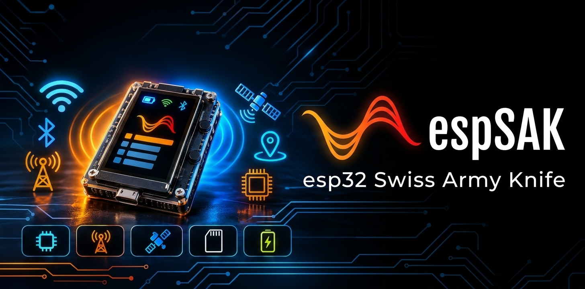
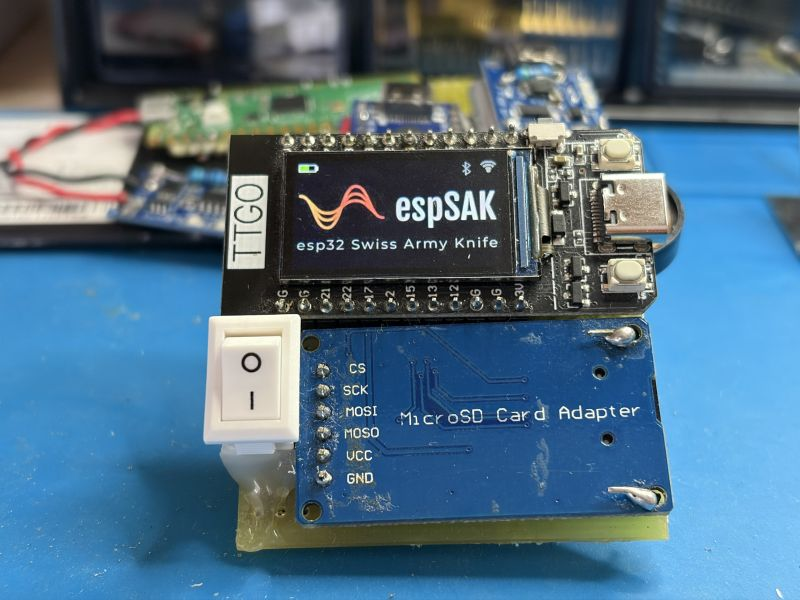
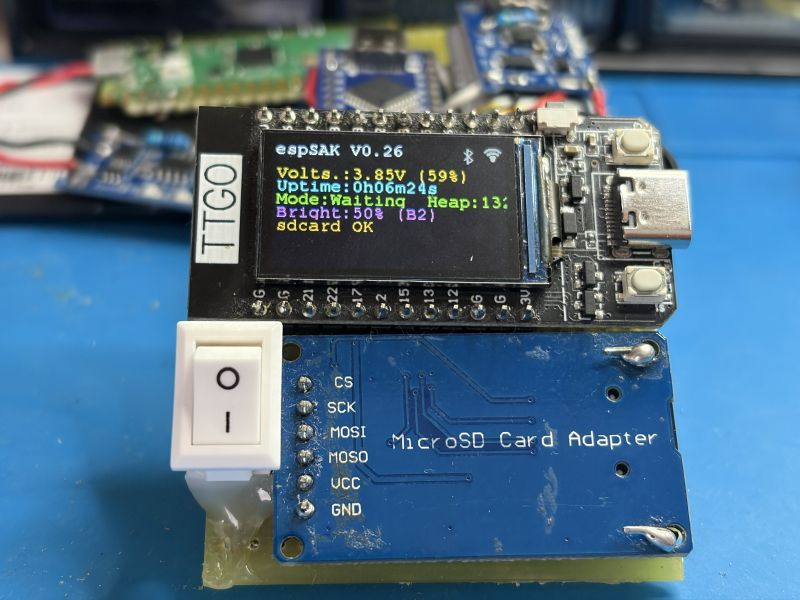
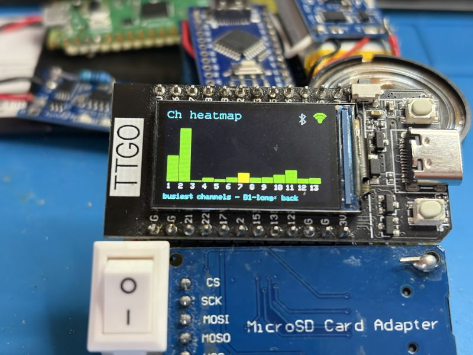
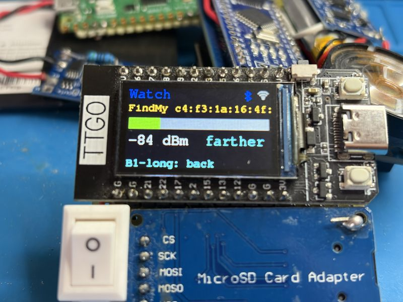
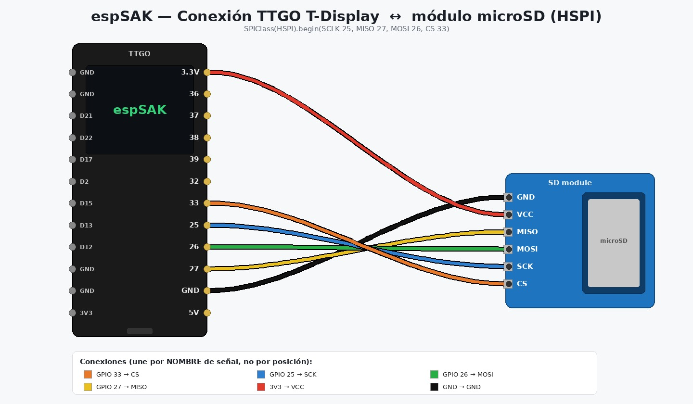
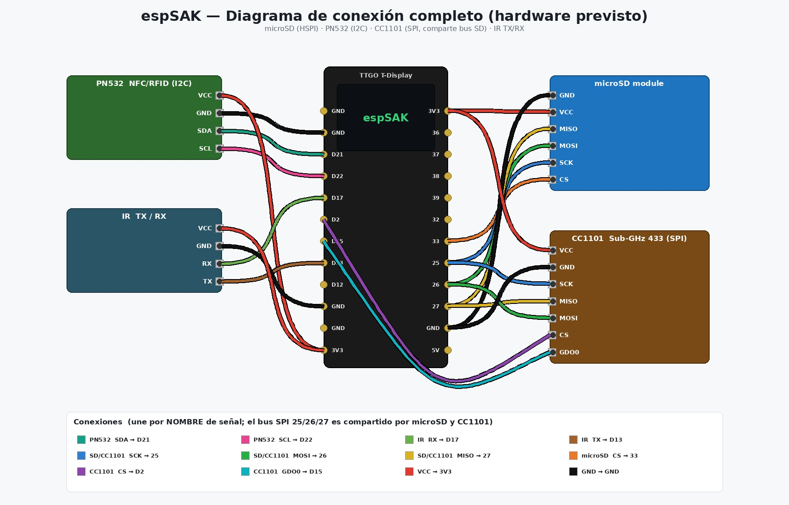

<div align="center">
  

  # ⚡ espSAK — ESP32 Swiss Army Knife
  **The ultimate pocket-sized, ultra-low-cost wireless auditing & diagnostic multi-tool.**

  *Why spend $200+ on a Flipper Zero when you can build a native Wi-Fi & BLE pocket powerhouse for a fraction of the price?*
</div>

---

## 🎯 Why espSAK?

**espSAK (ESP32 Swiss Army Knife)** is a portable, open-source wireless multi-tool built around the compact **LilyGO / TTGO T-Display (ESP32)**. Inspired by the Swiss Army Knife concept, it packs Wi-Fi packet analysis, Bluetooth/BLE discovery, AirTag/tracker detection, SD card logging, and a customizable captive portal into a device that fits in your pocket.

Unlike expensive, closed-source commercial gadgets, **espSAK** gives you total freedom over hardware and firmware at a fraction of the cost.

### 🔥 espSAK vs. Flipper Zero

| Feature | 🐬 Flipper Zero | ⚡ espSAK (TTGO T-Display) |
| :--- | :--- | :--- |
| **Approximate Cost** | ~$170 – $200+ (plus add-ons) | **~$12 – $18** (all-in) |
| **Native Wi-Fi** | ❌ No (requires external Wi-Fi devboard) | ✅ **Built-in** (Promiscuous mode, Heatmaps, Deauth) |
| **Bluetooth & BLE** | Basic BLE | ✅ **Full Dual-Mode** (Classic SPP Console, BLE & Tracker Radar) |
| **Color Display** | Monochrome LCD | ✅ **1.14" IPS Color TFT** (240×135) |
| **Expandability** | Proprietary GPIO header | ✅ **Standard I2C / SPI** (Ready for CC1101 & PN532) |
| **Firmware Limits** | Regional frequency locks | ✅ **100% Open & Unrestricted** |

---

## 📸 Device & UI Gallery

| Main Interface & Wi-Fi Analysis | Bluetooth & Tracker Radar |
| :---: | :---: |
|  |  |
| **Captive Portal & System Info** | **Hardware Build & Portability** |
|  |  |

---

## 🚀 Roadmap (Upcoming Modules)

The current hardware pinout leaves free SPI and I2C buses specifically reserved for upcoming expansion modules:
- [x] **Core System:** Non-blocking state machine, battery management, SD file manager & Wi-Fi Web Server.
- [x] **Wi-Fi Suite:** Async scanner, Probe monitor, Deauth detector, Channel Heatmap & Client mapper.
- [x] **Bluetooth Suite:** Classic BT discovery, SPP Serial Console, BLE scanner & AirTag/Tile/SmartTag tracker radar.
- [x] **Captive Portal:** Custom HTML templates, DNS wildcard & SD logging.
- [ ] **Sub-GHz Transceiver (CC1101):** Signal capture, frequency analyzer, and replay attacks (315/433/868/915 MHz).
- [ ] **NFC / RFID (PN532 via I2C):** Reading, dumping, and emulating proximity cards/tags using free GPIOs 21 & 22.

---

## Hardware

The project is built around a **LilyGO / TTGO T-Display ESP32-WROOM** development board.

| Component | Description |
|---|---|
| Main board | TTGO T-Display (ESP32-WROOM) |
| Display | 1.14" TFT, ST7789, 240 × 135 |
| Flash | 16 MB |
| Storage | microSD card reader (SPI) |
| Power | 1-cell LiPo battery |
| Charging | USB-C |
| Controls | 2 physical buttons |

### Hardware assembly

Two hardware configurations are documented:

**V1 — Base configuration with microSD**



**V2 — Complete configuration with all currently installed modules**



See the `hardware/` directory for connection diagrams and additional details.

---

## Features

### 1. System information

- Battery voltage and estimated charge percentage.
- Charging status indication.
- System uptime.
- Free heap memory.
- SD card status.
- Adjustable screen brightness.

### 2. WiFi tools

- **WiFi Scan:** asynchronous network scanning, RSSI information and paginated results.
- **Probe Scan:** monitors directed probe requests from nearby devices.
- **Deauth Detector:** detects deauthentication and disassociation frames and displays activity rates.
- **Channel Heatmap:** visualizes packet activity across WiFi channels.
- **Clients:** identifies wireless clients and maps their MAC addresses to their associated access points.

The monitoring tools use ESP32 promiscuous mode with channel hopping where applicable.

### 3. Bluetooth tools

- **Serial Console (SPP):** Bluetooth Classic serial interface with remote system information and file-management commands.
- **BT Discovery:** discovers nearby Bluetooth Classic devices and identifies their device classes.
- **BLE Scan:** scans BLE advertisements and classifies manufacturers.
- **Trackers:** detects supported AirTag / Find My, Tile and SmartTag advertisements.
- **Watch Mode:** follows the RSSI signal strength of a selected tracker, providing a hot/cold proximity indication.

### 4. Captive Portal

A configurable captive portal with:

- Start / Stop controls.
- Portal status screen with IP information and recent requests.
- DNS wildcard redirection.
- Client request logging to the microSD card.
- Configurable access point SSID and IP address.
- Selectable HTML pages stored in `/config/`.
- Built-in default HTML page as fallback.

The portal picker automatically lists available `.html` files in `/config/`.

### 5. SD Card Manager

- File and directory explorer.
- Text file viewer.
- Hexadecimal preview for binary files.
- File deletion with confirmation.
- Recursive file wipe with confirmation.
- Dedicated logging folders.
- Configuration preservation during the Wipe All operation.

### 6. SD Card Web Server

A password-protected WPA2 access point provides a web interface to:

- Browse SD card directories.
- Download stored files.
- Delete files remotely.

### 7. Power management

- Battery monitoring.
- Charging indication.
- Four brightness levels.
- Configurable inactivity timeout.
- Automatic standby mode.
- Wake-up using Button 1.

---

## Controls

The device uses two physical buttons.

| Action | Button |
|---|---|
| Next / Cycle / Page | Button 2 — short press |
| Select / Enter | Button 1 — short press |
| Back / Up | Button 1 — long press |
| Change brightness | Button 2 in System Info |
| Wake from standby | Button 1 |

The long-press duration is configurable through the SD card configuration file.

---

## Hardware pinout

### Currently used GPIOs

| Function | GPIO |
|---|---|
| TFT CS | 5 |
| TFT SCLK | 18 |
| TFT MOSI | 19 |
| TFT DC | 16 |
| TFT RST | 23 |
| TFT Backlight | 4 |
| SD CS | 33 |
| SD SCLK | 25 |
| SD MISO | 27 |
| SD MOSI | 26 |
| Button 1 | 35 |
| Button 2 | 0 |
| Battery ADC | 34 |
| ADC Enable | 14 |

### Available GPIOs

| GPIO | Notes |
|---|---|
| 21 | I2C SDA (Reserved for future NFC/PN532) |
| 22 | I2C SCL (Reserved for future NFC/PN532) |
| 17 | Free, output capable (Sub-GHz / CC1101) |
| 13 | Free, output capable (Sub-GHz / CC1101) |
| 2, 15 | Strapping pins — use with caution |
| 32 | Free if exposed on the board variant |
| 37, 38 | Input only, if exposed |

> **Warning:** GPIO 12 should be avoided because it affects the ESP32 flash voltage configuration at boot.

---

## SD Card structure

The device automatically creates the required folders when the SD card is initialized.

```text
/
├── captive/
│   └── cap_000.txt
│
├── wifi/
│   └── scan_000.txt
│
├── probe/
│   └── probe_000.txt
│
├── bt/
│   └── bt_000.txt
│
├── track/
│   └── trk_000.txt
│
└── config/
    ├── config.txt
    └── index.html
```

Log files are stored as `.txt` files, with timestamped session headers. New log filenames are automatically selected to avoid overwriting existing sessions.

### Configuration

The `/config/config.txt` file is automatically created with default values when missing.

| Parameter | Description |
|---|---|
| `brightness` | Screen brightness level (0–3) |
| `captive_ssid` | Captive portal AP name |
| `websrv_ssid` | SD web server AP name |
| `websrv_pass` | Web server AP password (empty = random password per session) |
| `longpress_ms` | Button long-press duration |
| `idle_min` | Inactivity timeout in minutes |
| `captive_html` | Selected captive portal HTML page |
| `captive_ip` | Captive portal AP IP address |
| `websrv_ip` | SD web server AP IP address |

The captive portal HTML template is stored in `/config/index.html`. Additional `.html` files can be placed in `/config/` and selected directly from the device menu. An empty or invalid `captive_html` setting falls back to the internal HTML page.

> **Note:** The device creates missing configuration files automatically. Keep a backup of your customized SD card configuration before using Wipe All.

---

## Software requirements

### Required libraries

- `TFT_eSPI`
- `Button2` by Lennart Hennigs
- `SD`
- `FS`
- `WiFi`
- `BluetoothSerial`
- `BLEDevice`
- `BLEScan`
- `BLEAdvertisedDevice`
- `DNSServer`
- `esp_wifi`
- `SPI`

The ESP32-specific libraries are provided by the ESP32 Arduino core.

### TFT_eSPI configuration

Configure `User_Setup_Select.h` in the TFT_eSPI library for:

**ESP32 + TTGO T-Display ST7789V**

Make sure the display pin configuration matches the hardware.

### Arduino IDE settings

| Setting | Value |
|---|---|
| Board | TTGO T-Display or ESP32 Dev Module |
| Partition Scheme | Huge APP (3MB No OTA / 1MB SPIFFS) |
| Flash size | 16 MB |
| Serial Monitor | 115200 baud |

> **IMPORTANT:** The `Huge APP (3MB No OTA / 1MB SPIFFS)` partition scheme is required for the current firmware.

WiFi, Bluetooth Classic and BLE are used together in the firmware. The device switches between WiFi and Bluetooth modes, deinitializing the previous radio mode to avoid controller conflicts.

### Compile and upload

1. Install the ESP32 board support package in Arduino IDE.
2. Install the required libraries.
3. Configure `TFT_eSPI` for the TTGO T-Display.
4. Select the correct board and partition scheme.
5. Open `espSAK.ino`.
6. Compile and upload the firmware.
7. Insert a FAT-formatted microSD card.
8. Power on the device.

---

## Software architecture

espSAK uses a non-blocking state-machine architecture.

The main loop handles:

- Battery monitoring.
- Captive portal background services.
- Button input processing.
- State transitions.
- Individual screen updates.
- Automatic standby management.

WiFi promiscuous monitoring uses a shared receive callback that dispatches packets according to the selected WiFi tool.

Bluetooth Classic, BLE and WiFi modes are initialized and deinitialized independently to prevent radio controller conflicts and optimize heap memory.

---

## ⚠️ Legal Disclaimer

**espSAK** is designed strictly for educational purposes, experimentation, wireless diagnostics, and authorized security testing in your own lab environment.

Do not use this tool against networks, devices, or individuals without explicit permission. The author assumes no responsibility for any misuse or damage caused by this project.
